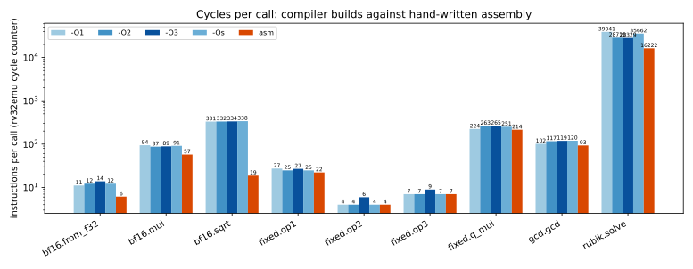
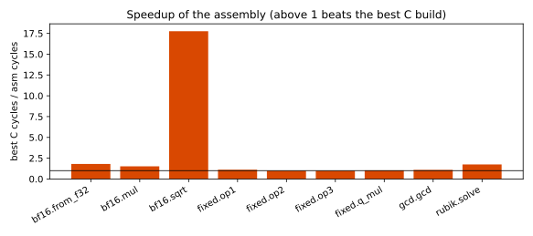
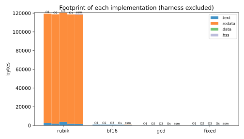

# Complete Applications on Bare-Metal RV32I

## Scope and reproducibility

This work implements four applications with portable C and manually written RV32I assembly: an optimal pocket-cube solver, software BFloat16 operations, binary greatest common divisor, and logic-based arithmetic with Q11.20 multiplication. The implementation follows the contract headers rather than assuming that every quiz operation has standard IEEE 754 behavior.

The implementation discussed here is pinned at [c39eb59](https://github.com/ilian5210/arch2026-progs/tree/c39eb59dfd275bfc0f1d7696abca517c9cd22db5/src). The original framework is fd2d7c1. Measurements use xPack GCC 15.2.0, GNU binutils 2.45, and rv32emu 9dbff65c4d6a40d64d3bbb38f4c5a20d6e885e24, built for system emulation with ELF loading, its interpreter, and the M, A, F and C extensions disabled. All compiler builds use RV32I with Zicsr, the ILP32 ABI, freestanding mode, and optimization levels O1, O2, O3 and Os. Application objects contain no system calls or counter accesses; the unchanged harness owns those operations. The C functions also run on the host under AddressSanitizer and UndefinedBehaviorSanitizer.

The timing harness calls both implementations on identical arrays and subtracts a matching loop baseline. It reports 64-bit differences and checks observable checksums. Speedup compares assembly with the fastest C build in the same ELF; the size comparison separately chooses the smallest C build. rv32emu counts executed guest instructions and has no pipeline or cache timing model. These cycle figures therefore measure instruction cost, not hardware latency, stalls, cache misses or energy. Counts are deterministic; wall-clock time is not used as a speedup metric.

The Lab 2 playground was separately cloned at 914f7715 and rebuilt after cleaning at O0 and O2. All eight published verdicts passed at both levels. The logs are included in the evidence directory. For example, ChaCha20 uses 6,797 measured cycles at O0 and 4,322 at O2. Initialization, checking and printing are inside that playground interval, so these are not isolated cipher costs. Independently read cycle and instruction intervals can differ by one instruction even though both counters share the same underlying instruction counter.

## 1. Optimal pocket-cube solver

### Representation and correctness

Fixing one corner removes whole-cube rotations. The other seven corners have 7! permutations, and their orientations have six independent base-three digits because the total twist is zero modulo three. The state space therefore contains

$$7!\,3^6=3,674,160$$

states. The nine unit-cost moves are R, R2, R', B, B2, B', D, D2 and D'. A half turn counts as one move. The graph has diameter eleven.

The solver stores a full permutation rank p in [0,5039], an orientation rank o in [0,728], and the ordered positions pp of three distinguished corners in [0,209]. It uses quarter-turn tables and repeats a quarter turn to enumerate the three moves of a face. The heuristic is

$$h(p,o,pp)=\max(d_P[p],d_A[o,pp]).$$

The first distance ignores orientations. The second retains orientations and the three corner positions but forgets the other identities. Every concrete move projects to an abstract move with the same cost. Projecting a concrete solution therefore yields an abstract solution of no greater length, proving that each distance is a lower bound. Their maximum is also a lower bound; adding them would need a separate cost-partition argument.

Iterative deepening begins at h and increases its bound through eleven. A node is rejected when its remaining allowance is less than either heuristic component. Adjacent moves of one face can be combined into at most one move, so excluding consecutive turns of the same face preserves at least one shortest path. The first successful bound is consequently optimal. This is an exact discrete algorithm, so numerical approximation error is not applicable.

### Bare-metal interface and storage

The [C interface](https://github.com/ilian5210/arch2026-progs/blob/c39eb59dfd275bfc0f1d7696abca517c9cd22db5/src/rubik/rubik.c) parses all fourteen characters, rejects repeated corners and invalid twist sums, and validates before writing the output. Invalid input returns -1 without changing the output. The complete text length, including separators and the terminating zero, is checked before writing. Insufficient capacity returns -2 and clears the first byte only when capacity is nonzero. A solved cube returns zero and an empty string when it fits.

The [assembly implementation](https://github.com/ilian5210/arch2026-progs/blob/c39eb59dfd275bfc0f1d7696abca517c9cd22db5/src/rubik/rubik.S) preserves the ABI's saved registers. The wrapper and search each reserve an 80-byte frame; search depth does not grow the call stack. Twelve explicit 64-byte search frames occupy 768 bytes of static storage. This fits the fixed 4 KiB stack environment. Static search frames make this implementation non-reentrant, which is sufficient for the single-threaded harness.

The packed abstract table contains 729 times 210 distances, stored two per byte: 76,545 bytes. The permutation, orientation and partial-permutation transition tables and permutation distances bring table contents to 116,829 bytes. Each implementation defines its own copy, as required by separate object accounting. The assembly totals 119,213 allocated bytes, including code, constants and search storage, below 131,072 bytes.

### Optimization and evidence

The expensive packed-table lookup is skipped immediately when the cheaper permutation distance already exceeds the remaining allowance. Row offsets use shifts and additions: 105o = 64o + 32o + 8o + o. The assembly keeps current coordinates in registers, advances a frame pointer, and caches the selected face's table addresses. This avoids repeated indexing of C's parallel arrays and its entered flags.

This [search excerpt](https://github.com/ilian5210/arch2026-progs/blob/c39eb59dfd275bfc0f1d7696abca517c9cd22db5/src/rubik/rubik.S#L319) shows the inexpensive rejection before the packed lookup:

```asm
search_node:
    addi s7, s7, 1
    add t0, s4, s9
    lbu t2, 0(t0)
    bltu s1, t2, search_backtrack
```

Here s9 is the current permutation rank, s4 points to its distance table, and s1 is the remaining depth allowance. Rejecting here avoids every address calculation and nibble extraction for the second heuristic. The O2 C listing computes equivalent bounds through the C search state; the manual search keeps its active coordinates and table bases live in saved registers.

The compiler's O3 build is fastest on the shared benchmark at 28,328.8 instructions per call. Assembly needs approximately 16,224.8 in that same ELF, a 1.75-times speedup. The displayed O2 assembly figure is 16,222.3; the small difference comes from the benchmark caller, not a different assembly object. O3 expands C code to 3,688 bytes, while Os uses 1,776. Assembly code uses 1,524 bytes, but its explicit static frames make its total allocation 573 bytes larger than the smallest C implementation. Code size and complete footprint must be distinguished.

All official depth, replay, invalid-state and buffer-boundary tests pass. An extra target run checks every one of the 2,644 distance-eleven states obtained from the first assignment's independent breadth-first oracle. Every returned path has eleven moves and solves the state in the independent cubie replay. The most expensive call retires 6,858,082 instructions for state 12347651111111, below the 7,500,000 limit. This complete hardest-layer check complements the published development vectors; it does not claim a fresh target sweep of every one of the 3,674,160 states.

The same techniques apply to small embedded planning problems: rank a finite state space, precompute compact lower bounds, and keep the exact search on the target. The principal tradeoff is read-only table space against search work.

## 2. Software BFloat16

### Format, narrowing and special values

A normal BFloat16 value has sign s, an eight-bit exponent E with bias 127, and seven fraction bits f:

$$x=(-1)^s(128+f)2^{E-134}.$$

The smallest positive normal is 2^-126; the smallest positive subnormal is 2^-133. The largest finite magnitude is (2-2^-7) times 2^127. Eight significant bits give a normal spacing of 2^(E-134). Round-to-nearest has error at most half an ULP away from overflow; relative error is bounded by 2^-8 for normal results. Special classes and subnormal relative errors require separate treatment.

The [C implementation](https://github.com/ilian5210/arch2026-progs/blob/c39eb59dfd275bfc0f1d7696abca517c9cd22db5/src/bf16/bf16.c) carries binary32 values as unsigned integer bit patterns. For finite input u, narrowing computes

$$\operatorname{top16}(u+\mathtt{0x7FFF}+((u\mathbin{\gg}16)\mathbin{\&}1)).$$

The retained least significant bit makes exact halfway cases round to even. Exponent-255 inputs instead return the original upper half unchanged, including the specified payload behavior. The [assembly](https://github.com/ilian5210/arch2026-progs/blob/c39eb59dfd275bfc0f1d7696abca517c9cd22db5/src/bf16/bf16.S) adds a mathematical fast path: if the discarded half is less than 0x8000, rounding cannot increase the upper half in any class. A shift and sign test identify this region. The normal path remains available for all other inputs. This reduces the benchmark from an initial approximately 11.2 instructions per assembly call to 6.1, versus 11.1 for the best compiler build.

The [fast path](https://github.com/ilian5210/arch2026-progs/blob/c39eb59dfd275bfc0f1d7696abca517c9cd22db5/src/bf16/bf16.S#L8) begins with:

```asm
    slli t0, a0, 16
    bgez t0, .Lf32_top
```

Moving discarded bit 15 into the sign position tests the entire below-halfway region with one branch. The O2 compiler listing of the direct C formula instead performs its exponent check and rounding arithmetic even for these finite inputs.

### Multiplication

Normalizing a nonzero subnormal shifts its leading one into bit seven and adjusts its exponent. Two eight-bit significands multiply to at most 65,025. The result may require one extra normalization shift; the exponent then increases by one. Fraction bits are truncated, not rounded. For normal finite products, this has relative error less than 2^-7. Overflow produces signed infinity.

The required underflow rule shifts the stored fraction after discarding its implicit leading one. It therefore differs from a conventional correctly rounded floating-point multiply: minimum-normal times one half returns zero under this contract. That example has 100% relative error against exact real multiplication. The normal-result error bound must not be extended to all underflow results.

Special values are examined in operand order. A NaN first operand is returned unchanged. An infinite first operand and a NaN second operand yield signed infinity. Infinity times zero produces the specified quiet NaN. These are contract semantics rather than interchangeable algebraic cases.

The C significand multiply calls the supplied software multiplier. The normalized assembly multiplier always has its top bit set, so assembly starts with that contribution and unrolls only the remaining seven bit steps. No hardware multiply is required. It needs 57.4 benchmark instructions per call, compared with 87.2 for the best C build: a 1.52-times speedup.

A host sweep of all 16,384 normal significand pairs with representative exponent 127 found maximum relative error 0.7691842%, at operands 0x3F9E and 0x3FD1. This covers the normalized significand approximation, not every special or underflow class. Official golden grids, full-operand columns and boundary tests separately check those classes.

### Square root

For a positive normal, write its value as m times 2^e. If e is odd, double m and reduce e by one. The quiz searches for the largest integer r satisfying

$$\lfloor r^2/128\rfloor\le m.$$

Since r is nonnegative and integral, this is equivalent to

$$r^2\le128(m+1)-1,\qquad r=\operatorname{isqrt}(128(m+1)-1).$$

Using isqrt(128m) would implement a different rounding boundary. Only seven fraction bits and exponent parity determine this root: there are 256 possibilities. Assembly stores their exact integer roots in a 256-byte table and computes the resulting biased exponent as floor((E+127)/2). This replaces repeated search and software multiplication with one lookup. The table is derived from the formula for the complete normalized domain, not from benchmark inputs.

The C binary-search baseline is retained for comparison. Assembly needs 18.6 benchmark instructions per call against 330.8 for the best C build, a 17.76-times speedup. Across all 32,512 positive normal inputs, comparison with a host double-precision square root gives maximum relative error 0.3883509816%, at input 0x0081 with output 0x2000. Every one of the 65,536 bit patterns also passes the published golden result check. NaNs are preserved, negative nonzero inputs give the quiet NaN, and both signed zeros and positive subnormals produce positive zero as specified.

The complete BF16 assembly uses 612 code bytes and 256 table bytes, whereas the smallest C build uses 720 bytes. The lookup therefore buys substantial speed at a 148-byte total-size cost. Software BF16 is useful for compact numerical storage and machine-learning data exchange on processors without floating point; its exact rounding and exceptional-value contract must remain explicit.

## 3. Binary greatest common divisor

The identities gcd(2a,2b)=2gcd(a,b), gcd(2a,b)=gcd(a,b) for odd b, and gcd(a,b)=gcd(a,b-a) justify Stein's algorithm. Zero is handled first. The algorithm records the common power of two, makes one operand odd, removes powers of two from the other, orders the odd operands, and subtracts the smaller from the larger. The maximum operand decreases, proving termination. Values remain unsigned 32-bit integers. Subtraction occurs only after ordering, so it does not underflow. The final result divides the original operands and is representable. Arithmetic and numerical error are exact.

The [portable C version](https://github.com/ilian5210/arch2026-progs/blob/c39eb59dfd275bfc0f1d7696abca517c9cd22db5/src/gcd/gcd.c) expresses those identities directly. The [assembly](https://github.com/ilian5210/arch2026-progs/blob/c39eb59dfd275bfc0f1d7696abca517c9cd22db5/src/gcd/gcd.S) places the trailing-zero test at the bottom of each shift loop and handles equality without swapping. Most usefully, subtracting two odd values guarantees an even result. A nonzero difference therefore branches directly to the first shift, avoiding a redundant test of its known zero bit.

The [subtraction tail](https://github.com/ilian5210/arch2026-progs/blob/c39eb59dfd275bfc0f1d7696abca517c9cd22db5/src/gcd/gcd.S#L41) is:

```asm
.Lgcd_sub:
    sub a1, a1, a0
    bnez a1, .Lgcd_shift_b
    sll a0, a0, t0
```

The nonzero branch reaches an unconditional right shift. In contrast, the O2 compiler listing returns from a subtraction to the bit-zero test, followed by a branch into the shift path. The manual branch removes a test whose result follows from the odd-operand invariant.

The intermediate assembly averaged about 101.8 instructions per benchmark call. Removing that redundant test reduces it to 92.9, while the best compiler build averages 101.6: a 1.09-times speedup. Assembly uses 124 code bytes; the smallest C build uses 120. O1 is fastest among the compiler builds here; stronger optimization is not automatically better for this branch-heavy routine.

The tests compare with an independent divider-based Euclidean reference, cover all 65,536 pairs below 256, powers of two, shared factors, zero, maximal unsigned values, random inputs and Fibonacci identities. Both implementations remain within their separate instruction budgets. The routine applies to ratio reduction, integer normalization and number-theoretic computations on processors where division is expensive or unavailable.

## 4. Logic arithmetic and Q11.20

### Carry propagation, subtraction and average

For unsigned 32-bit words, xor forms a sum without carries and twice the bitwise intersection forms the carry word. Repeating

$$c=(a\mathbin{\&}b)\ll1,\quad a\gets a\mathbin{\oplus}b,\quad b\gets c$$

preserves a+b modulo 2^32 and moves pending carries left until none remain. The pass count is part of the result, so replacing op1 with a single add would be wrong. No iteration occurs when the initial carry operand is zero. The C and assembly implementations preserve that observable count.

In contrast, op2 exposes only subtraction modulo 2^32, so one RV32I subtraction is sufficient. For op3,

$$\lfloor(a+b)/2\rfloor=(a\mathbin{\&}b)+((a\mathbin{\oplus}b)\gg1).$$

This uses the exact-sum decomposition a+b=2(a&b)+(a xor b). The result is at most the larger operand and cannot overflow. All three functions are exact for their contracts.

The [assembly](https://github.com/ilian5210/arch2026-progs/blob/c39eb59dfd275bfc0f1d7696abca517c9cd22db5/src/fixed/fixed.S) keeps the carry count in a register and stores it once, reducing op1 from 24.7 to 22.1 instructions per benchmark call against the best compiler. Op2 and op3 match the compiler's minimal instruction sequences, at 4.0 and 7.0 including the harness's call convention. Equal performance is reported honestly; there is no artificial slowdown of C. These identities apply to digital arithmetic, carry analysis and overflow-free averaging.

### Signed multiplication without a wide helper

A stored signed word A represents A/2^20. Its range is [-2048, 2048-2^-20], with resolution 2^-20. For an exact signed product P=A times B, the contract requires

$$R=\operatorname{low32}(\lfloor(P+2^{19})/2^{20}\rfloor).$$

Halfway cases round toward positive infinity: the stored products of 3 and 524288 give 2, while -3 and 524288 give -1. Overflow wraps modulo 2^32 rather than saturating.

The [C implementation](https://github.com/ilian5210/arch2026-progs/blob/c39eb59dfd275bfc0f1d7696abca517c9cd22db5/src/fixed/fixed.c) holds a wide magnitude in two unsigned words. Addition propagates carry, and shifting transfers bit 31 of the low word to the high word. Sign correction uses two's complement. The explicit pair also prevents a compiler from replacing a wide shift-and-add loop with an unavailable wide multiplication helper. The rounding carry is checked before extracting product bits 20 through 51. Unsigned word operations avoid signed-overflow undefined behavior and implementation-defined signed right shifts.

The [rounding and extraction](https://github.com/ilian5210/arch2026-progs/blob/c39eb59dfd275bfc0f1d7696abca517c9cd22db5/src/fixed/fixed.c#L48) is:

```c
hi += lo >= UINT32_C(0xfff80000);
uint32_t rounded = lo + (1u << (Q - 1));
uint32_t result = (rounded >> Q) | (hi << (32 - Q));
```

Adding 2^19 wraps the low word exactly when its original value is at least 2^32-2^19. Incrementing the high word on that condition preserves the wide sum. Joining the shifted words extracts the low 32 bits of the rounded, scaled product, including negative two's-complement products.

Assembly instead multiplies a signed multiplicand by the unsigned representation of the multiplier. If the multiplier was negative, subtracting the original multiplicand from the high word corrects the extra multiple of 2^32. It detects addition carry by comparing the new low word with an addend, saving a temporary move in every selected-bit addition. No external wide arithmetic helper is needed.

Before wrapping, the quantization error is at most 2^-21, or 4.7683715820e-7 in real units. Wrapping is a separate, much larger error relative to an unbounded real product. A deterministic 100,000-pair sweep against Python's arbitrary-precision integer formula matched every output bit. It included 99,586 overflow cases, explicitly testing wrap behavior. The largest observed pre-wrap error was 4.7682988225e-7. The supplied directed tests cover halfway rounding and signed extremes, with independent partial-product references and algebraic laws.

The assembly product averages 214.4 instructions per call against 223.5 for the best compiler build, a 1.04-times speedup. All four assembly routines together occupy 176 code bytes, compared with 220 for the smallest C build. This arithmetic suits image coordinates, control loops and signal processing on integer-only hardware, provided application ranges are chosen with the specified wrap behavior in mind.

## 5. Measured comparison and validation

The following tables are copied from the official measurement output. The assembly column is measured with the O2 caller; speedups use the caller of the fastest C variant. Full-precision CSV data, separate section sizes, environment revisions and additional-check logs are retained in [evidence](https://github.com/ilian5210/arch2026-progs/tree/main/docs/evidence).

| Function | -O1 | -O2 | -O3 | -Os | asm | best C | asm vs best C |
|---|---|---|---|---|---|---|---|
| bf16.from_f32 | 11.1 | 12.2 | 13.8 | 12.2 | 6.1 | 11.1 | 1.81x |
| bf16.mul | 94.3 | 87.2 | 88.6 | 91.3 | 57.4 | 87.2 | 1.52x |
| bf16.sqrt | 330.8 | 332.2 | 333.6 | 338.4 | 18.6 | 330.8 | 17.76x |
| fixed.op1 | 27.2 | 24.7 | 26.8 | 24.7 | 22.1 | 24.7 | 1.12x |
| fixed.op2 | 4.0 | 4.0 | 5.9 | 4.0 | 4.0 | 4.0 | 1.00x |
| fixed.op3 | 7.0 | 7.0 | 8.9 | 7.0 | 7.0 | 7.0 | 1.00x |
| fixed.q_mul | 223.5 | 262.7 | 264.6 | 251.2 | 214.4 | 223.5 | 1.04x |
| gcd.gcd | 101.6 | 116.6 | 118.8 | 119.7 | 92.9 | 101.6 | 1.09x |
| rubik.solve | 39041.0 | 28710.3 | 28328.8 | 35662.5 | 16222.3 | 28328.8 | 1.75x |

| Program | Variant | .text | .rodata | .data | .bss |
|---|---|---|---|---|---|
| rubik | asm | 1524 | 116921 | 0 | 768 |
| rubik | -O1 | 2520 | 116864 | 0 | 0 |
| rubik | -O2 | 1884 | 116864 | 0 | 0 |
| rubik | -O3 | 3688 | 116864 | 0 | 0 |
| rubik | -Os | 1776 | 116864 | 0 | 0 |
| bf16 | asm | 612 | 256 | 0 | 0 |
| bf16 | -O1 | 840 | 0 | 0 | 0 |
| bf16 | -O2 | 792 | 0 | 0 | 0 |
| bf16 | -O3 | 792 | 0 | 0 | 0 |
| bf16 | -Os | 720 | 0 | 0 | 0 |
| gcd | asm | 124 | 0 | 0 | 0 |
| gcd | -O1 | 140 | 0 | 0 | 0 |
| gcd | -O2 | 140 | 0 | 0 | 0 |
| gcd | -O3 | 140 | 0 | 0 | 0 |
| gcd | -Os | 120 | 0 | 0 | 0 |
| fixed | asm | 176 | 0 | 0 | 0 |
| fixed | -O1 | 276 | 0 | 0 | 0 |
| fixed | -O2 | 284 | 0 | 0 | 0 |
| fixed | -O3 | 284 | 0 | 0 | 0 |
| fixed | -Os | 220 | 0 | 0 | 0 |

The unmodified local grader reports 100/100. Every one of the four optimization levels passes 52 Rubik, 42 BF16, 34 GCD and 38 fixed-point named tests, including shared runtime checks: 166 per configuration and 664 named test executions overall. The sweeps inside those tests cover many more individual inputs. Sanitizers pass for all four portable C implementations, ISA scans reject forbidden instructions and unresolved helpers, and the commit history and formatting checks pass. The instructor may still use additional inputs and newer harness revisions; these development results do not replace that evaluation.

A fresh full clone of the instructor's framework at fd2d7c17db223807c342e3f210c769d23d1865b1 also grades the submission at 100/100 using its own harness, sanitizers and freshly built emulator. The [verification log](https://github.com/ilian5210/arch2026-progs/blob/main/docs/evidence/trusted-grade.log) records that separate check. The final local update still selects rv32emu 9dbff65c4d6a40d64d3bbb38f4c5a20d6e885e24.

The smallest footprint is selected independently from the fastest build. Rubik, BF16 and fixed-point C code are smallest at Os; GCD is also smallest at Os. Assembly reduces fixed-point total allocation, trades four extra bytes for GCD speed, trades a BF16 lookup table for faster square roots, and spends Rubik static frames to simplify the hot search loop. The charts are available as separate cycle, speedup and footprint figures; raw terminal logs accompany the key correctness checks.







To reproduce on this Mac, run the project helper with make test, make sanitize and make cycles. The helper selects the installed GCC 15.2 toolchain, analysis Python environment and modern Bash without modifying the framework's Makefile. Source changes were committed in small steps with the official hooks and their Change-Id chain. No test, contract header, grading script or budget was changed.

```sh
./mytests/run.sh make test
./mytests/run.sh make sanitize
./mytests/run.sh make dump
./mytests/run.sh make cycles
./mytests/run.sh python3 mytests/analyze_errors.py
./mytests/run.sh sh mytests/check_hard.sh
```

The arithmetic script builds a temporary host library from the submitted C files, measures error against host double precision for BF16, and uses arbitrary-precision integer arithmetic for fixed-point results and quantization error. The extra Rubik harness uses the official independent move replay on the complete distance-eleven list. Its generator can rebuild that list from the independent breadth-first oracle in the Assignment 1 checkout. These extra tests stay outside the graded source directories.

## 6. Completion boundary and interview

CodeTrial was built from source at 0406460cb9e7f96196bd278fc0a2d3cedb6a8fe1 using its pinned Rust 1.99.1 toolchain, and its local setup page was verified. Credential setup, a practice attempt and the completed recorded interview remain separate user actions. This report does not claim an interview result or recording. The final recording must include the complete task flow and both voices. During the actual attempt, answers and C code must come from the candidate; outside AI assistance is forbidden by the assignment.

## References

- [Assignment 2 requirements](https://hackmd.io/@sysprog/2026-arch-homework2).
- [Published framework and contracts](https://github.com/sysprog21/arch2026-progs).
- [Lab 2: RISC-V instruction-set simulator and system emulator](https://hackmd.io/@sysprog/Sko2Ja5pel).
- [Optimizing 2D Line Drawing on RV32I[M] with Fixed-Point Arithmetic](https://hackmd.io/@sysprog/line-draw-fixed-point), used as a model for format, bounds and instruction analysis; M instructions are not used here.
- [Approximating the Sine Function in BF16](https://hackmd.io/@sysprog/bf16-sine), used as a model for separating mathematical approximation, rounding and measured error.
- [RISC-V Assembly Programmer's Manual](https://github.com/riscv-non-isa/riscv-asm-manual).
- [CodeTrial task mode](https://github.com/sysprog21/codetrial/blob/0406460cb9e7f96196bd278fc0a2d3cedb6a8fe1/docs/task-mode.md).
